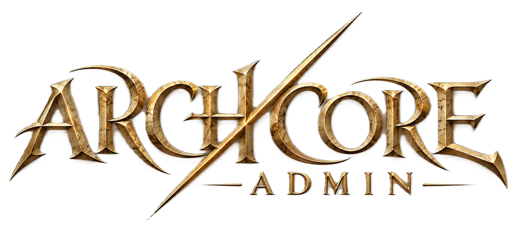
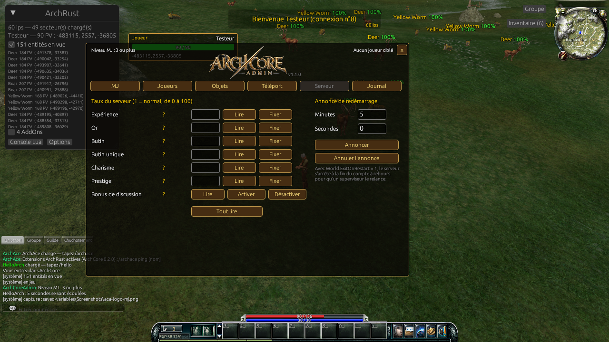

<p align="right"><a href="README.md">🇫🇷 Lire en français</a></p>

<p align="center">
  
</p>

<h1 align="center">ArchCore Admin</h1>

<p align="center">
  <b>GM panel for ArchRust and ArchCore</b><br>
  Lua AddOn · Ace3 · ArchCore GM commands<br><br>
  <a href="https://github.com/BlaMacfly/ArchCoreAdmin/actions/workflows/tests.yml"></a>
  <a href="https://github.com/BlaMacfly/ArchCoreAdmin/releases/latest"></a>
</p>

Game Master (GM) panel for the **ArchRust** client, connected to an
[**ArchCore**](https://github.com/BlaMacfly/ArchCore) server. It is a Lua AddOn built on the idea of
[AzerothAdmin](https://github.com/superstyro/azerothadmin) (WoW 3.3.5 / AzerothCore): tabs of
buttons that type the GM commands for you, and the server's replies read back into the panel.



## How it works

| AzerothAdmin (WoW) | ArchCore Admin (ArchRust) |
|---|---|
| `.gm on`, `.tele`, `.additem`… | ArchCore's `/kill`, `/move x,z`, `/create`… (`crates/archcore/src/world/gm.rs`), the same commands as Archonia's "Admin Commands" panel |
| `SendChatMessage(".cmd")` | `RunMacroText("/cmd")`: the client forwards any `/` command it does not know to the server, without echoing it in the chat |
| hook on `ChatFrame:AddMessage` | `ChatFrame_AddMessageEventFilter`: ArchCore answers each command with **one** system-type chat message, which ArchRust delivers as `CHAT_MSG_SAY` **without an author**; `CHAT_MSG_SYSTEM` is watched too |
| `UnitIsPlayer("target")` | under ArchRust `UnitIsPlayer` is only true for yourself: other characters are recognised by their CID (< `0x40000000` on ArchCore) |
| GM level known to the client | not exposed to AddOns: the AddOn sends `/SetExp` without argument (no effect) and reads the reply (`Commande inconnue` → 0, `Niveau MJ 3 requis… (le vôtre : 2)` → 2, syntax error → 3 or more) |
| `.lookup item` | missing from ArchCore: the **client's item catalogue** (`ArchRust.GetItemTemplate`, `GetItemIcon`: ItemTemplateAll.ini, game icons) is used to pick items; without it (older client), items by TID, name **learnt** from the `/create` or `/additem` reply, favourites |
| `.lookup creature` | missing too: list of the monsters **met so far** (`ArchRust.GetUnits()`, targeted, simulated), kept from one session to the next |

Tabs: **GM** (detected level, `/invincible`, `/speed`, `/recast`, `/questreset`, free command with history,
command catalogue, options), **Players** (`/kill`, `/level`, `/money`, `/rename_char`, `/chatban`),
**Items** (game items shown with their icon, name, TID and required level, by category, search and
class; `/create`, `/additem`, the command's outcome explained, favourites), **Loot** (farm and loot
simulator: `/simloot <monster TID> <count> [drop rate] [gold rate]`, monster picked from a searchable
list, items obtained listed with icon, count and rate per 100 monsters),
**Teleport** (`/move`, saved points), **Server** (rates, chat bonus, `/announce_restart`), **Log**.
The **-** button next to the close button shrinks the window to a bar without losing the filled-in
fields; **+** (or the GM button, the key, `/aca`) restores it.

## Install

1. Download `ArchCoreAdmin-vX.Y.Z.zip` from [Releases](https://github.com/BlaMacfly/ArchCoreAdmin/releases)
   and copy its `ArchCoreAdmin/` folder into ArchRust's `addons/` folder, next to `ArchRust.exe`.
2. Give the account GM rights on the server, then log in again:
   `UPDATE archcore_auth.account SET gm_level = 3 WHERE username = 'admin';`
3. In game, open the panel with the **MJ** button, **Ctrl+Shift+A** or `/aca`.

`/aca gm|players|items|loot|teleport|server|log`, `/aca probe`, `/aca send <command>`,
`/aca bind <key>`, `/aca confirm on|off`, `/aca replies on|off`, `/aca launcher on|off`, `/aca reset`.

## Known limits

- ArchCore replies in French; `Replies.lua` follows the wording of `gm.rs`. If the server changes a
  sentence, the command still works but the panel no longer updates that value.
- The GM level probe shows up in the server's GM log once per login (can be turned off).
- A reply is matched with the oldest pending command (5 s at most).
- `/move` keeps your current height (ArchCore has no height map yet).
- The visual item picker needs an ArchRust client that gives the item catalogue to AddOns; otherwise
  the Items tab falls back to typing the TID. Item names are the client's (English).
- `/simloot` lists 40 kinds of items at most (the most frequent); the others are summed up on one
  line. 10,000 monsters at most per simulation; the killer level is your character's.
- Three gaps in ArchRust, described (in French) in
  [`docs/BESOINS-CLIENT-SERVEUR.md`](docs/BESOINS-CLIENT-SERVEUR.md); the panel uses each one as soon as it
  is filled:
  - the server's refusals (messages starting with `/`) do not reach AddOns: after 5 seconds the panel gives
    the possible causes without being able to tell which one applies;
  - the catalogue comes from the client's files, Archonia's additions included, and does not tell which
    items the server lacks, nor classes, sockets or stats: no class filter yet, and the tooltip stops at
    the body part;
  - no monster list: only the monsters met so far are offered.
- The catalogue is read in one go the first time the Items tab opens (about 0.6 s and 14 MB for 23,000
  items, measured on the test bench).

## Tests

```bash
cd tests/banc-essai
cargo run --release
```

The test bench loads the AddOn in `archrust-addons`, ArchRust's real Lua engine (from the
[BlaMacfly/ArchRust](https://github.com/BlaMacfly/ArchRust) repository), and checks 152 points:
loading, level probe (with and without a reply), argument building and validation, buttons greyed by
level, confirmation, reply parsing, target detection, mouse clicks, no overlapping widgets in the seven
tabs, item catalogue (categories, search, icons, mouse picking, favourites, tooltip), outcome of `/create`
and `/additem` (item given, refusals explained, server silence), monster list and search, loot simulation
(command sent, reply read, list and summary, refusal and silence), minimizing and restoring the window,
fallback without catalogue, SavedVariables. The fields ArchRust does not give yet (items missing from the
server, classes, sockets, stats, monster list) are simulated in Lua: their display is checked, not their
real source. It runs on GitHub Actions on every push. Tested in game on 2026-10-22 against a local ArchCore (Rust) + MariaDB; screenshots in
[`docs/captures/`](docs/captures/).

## License

GPL-3.0-or-later, like ArchRust, ArchCore and AzerothAdmin (no code is taken from it, only the idea).
