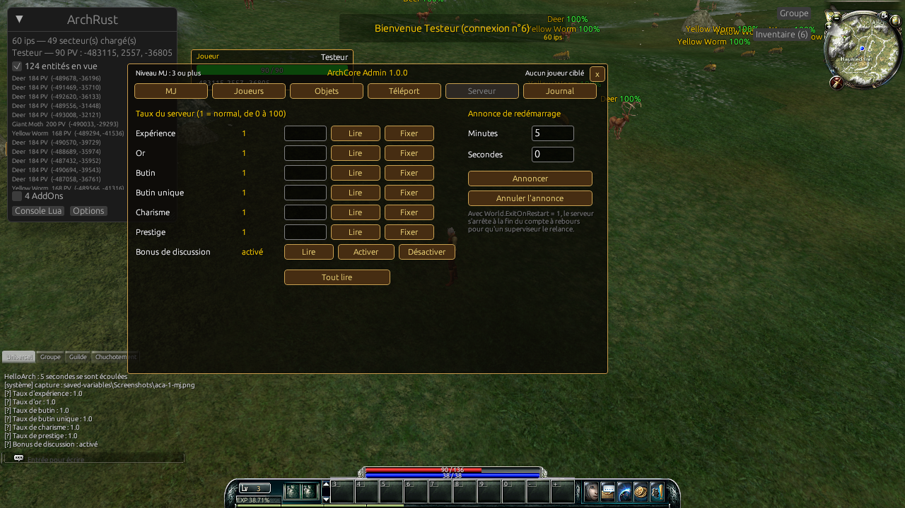

<p align="right"><a href="README.md">🇫🇷 Lire en français</a></p>

# ArchCore Admin

[](https://github.com/BlaMacfly/ArchCoreAdmin/actions/workflows/tests.yml)

Game Master (GM) panel for the **ArchRust** client, connected to an
[**ArchCore**](https://github.com/BlaMacfly/ArchCore) server. It is a Lua AddOn built on the idea of
[AzerothAdmin](https://github.com/superstyro/azerothadmin) (WoW 3.3.5 / AzerothCore): tabs of
buttons that type the GM commands for you, and the server's replies read back into the panel.



## How it works

| AzerothAdmin (WoW) | ArchCore Admin (ArchRust) |
|---|---|
| `.gm on`, `.tele`, `.additem`… | ArchCore's `/kill`, `/move x,z`, `/create`… (`crates/archcore/src/world/gm.rs`), the same commands as Archonia's "Admin Commands" panel |
| `SendChatMessage(".cmd")` | `RunMacroText("/cmd")`: the client forwards any `/` command it does not know to the server, without echoing it in the chat |
| hook on `ChatFrame:AddMessage` | `ChatFrame_AddMessageEventFilter`: ArchCore answers each command with **one** system-type chat message, which ArchRust delivers as `CHAT_MSG_SAY` **without an author**; `CHAT_MSG_SYSTEM` is watched too |
| `UnitIsPlayer("target")` | under ArchRust `UnitIsPlayer` is only true for yourself: other characters are recognised by their CID (< `0x40000000` on ArchCore) |
| GM level known to the client | not exposed to AddOns: the AddOn sends `/SetExp` without argument (no effect) and reads the reply (`Commande inconnue` → 0, `Niveau MJ 3 requis… (le vôtre : 2)` → 2, syntax error → 3 or more) |
| `.lookup item` | missing from ArchCore: items by TID, name **learnt** from the `/create` reply, favourites |

Tabs: **GM** (detected level, `/invincible`, `/recast`, `/questreset`, free command with history,
command catalogue, options), **Players** (`/kill`, `/level`, `/money`, `/rename_char`, `/chatban`),
**Items** (`/create`), **Teleport** (`/move`, saved points), **Server** (rates, chat bonus,
`/announce_restart`), **Log**.

## Install

1. Download `ArchCoreAdmin-vX.Y.Z.zip` from [Releases](https://github.com/BlaMacfly/ArchCoreAdmin/releases)
   and copy its `ArchCoreAdmin/` folder into ArchRust's `addons/` folder, next to `ArchRust.exe`.
2. Give the account GM rights on the server, then log in again:
   `UPDATE archcore_auth.account SET gm_level = 3 WHERE username = 'admin';`
3. In game, open the panel with the **MJ** button, **Ctrl+Shift+A** or `/aca`.

`/aca gm|players|items|teleport|server|log`, `/aca probe`, `/aca send <command>`,
`/aca bind <key>`, `/aca confirm on|off`, `/aca replies on|off`, `/aca launcher on|off`, `/aca reset`.

## Known limits

- ArchCore replies in French; `Replies.lua` follows the wording of `gm.rs`. If the server changes a
  sentence, the command still works but the panel no longer updates that value.
- The GM level probe shows up in the server's GM log once per login (can be turned off).
- A reply is matched with the oldest pending command (5 s at most).
- `/move` keeps your current height (ArchCore has no height map yet).

## Tests

```bash
cd tests/banc-essai
cargo run --release
```

The test bench loads the AddOn in `archrust-addons`, ArchRust's real Lua engine (from the `client`
branch of the ArchCore repository), and checks 52 points: loading, level probe, argument building
and validation, buttons greyed by level, confirmation, reply parsing, target detection, mouse
clicks, no overlapping widgets in the six tabs, SavedVariables. It runs on GitHub Actions on every
push. Tested in game on 2026-10-22 against a local ArchCore (Rust) + MariaDB; screenshots in
[`docs/captures/`](docs/captures/).

## License

GPL-3.0-or-later, like ArchRust, ArchCore and AzerothAdmin (no code is taken from it, only the idea).
